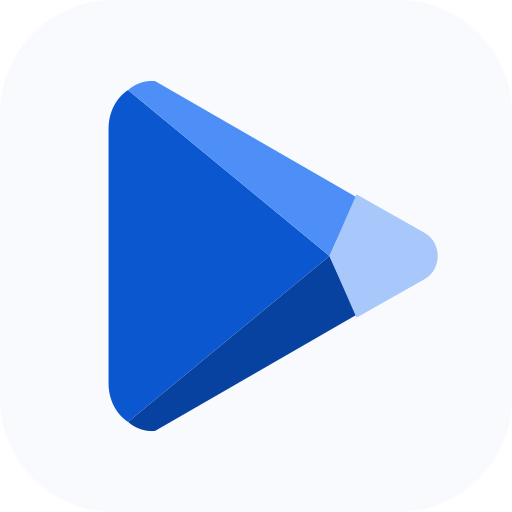

<p align="center">
  
</p>

<h1 align="center">Goggle Play</h1>

<p align="center">
  An independent Google Play catalog client for uncertified, unusual, and non-mobile Android devices.
</p>

Goggle Play lets an Android device browse, download, update, and install compatible apps from the Google Play catalog without requiring the official Play Store UI. It uses the device's real hardware profile by default, while allowing advanced users to report a custom device identity when testing compatibility on devices such as VR headsets, TVs, kiosks, and development boards.

> [!IMPORTANT]
> Goggle Play is an experimental, unofficial client. It is not affiliated with, sponsored by, or endorsed by Google LLC or Aurora OSS. Use a secondary account where appropriate and understand the risks before changing the reported device profile.

## Features

- Google Play-inspired Material interface with Apps, Games, search suggestions, home recommendations, top charts, app details, screenshots, ratings, and formatted descriptions.
- Accurate catalog search using Google Play's current web index, followed by authenticated GPlayAPI detail and compatibility lookups.
- Personal Google account authentication with an email and AAS token, or anonymous authentication through a custom Aurora Dispenser-compatible HTTPS endpoint.
- Encrypted credential and anonymous-token storage using AES-GCM keys held by Android Keystore.
- Reusable authentication and Google Play sessions. A dispenser token is reused until authentication fails or the user explicitly reconnects in Settings.
- Automatic detection of the current device's model, Android version, supported ABIs, screen properties, system features, memory, and CPU information.
- Optional custom device identity with configurable manufacturer, model, product, device codename, ABI list, API level, display, density, and locale.
- Concurrent background downloads with aggregate and per-file progress in the app and Android notifications.
- Base and split APK support, download integrity verification, and staged installs.
- Tap-to-install flow: downloading never opens the system installer automatically. The Android confirmation prompt appears only after the user taps a ready download.
- Manage screen listing apps installed from Google Play, Goggle Play, or an Aurora-backed Play client while excluding ordinary sideloaded APKs and ADB installs.
- Installed-version comparison and one-tap updates when a newer compatible Play version is available.

## Requirements

- Android 6.0 (API 23) or newer.
- Internet access.
- Permission to install unknown apps from Goggle Play.
- Notification permission on Android 13+ for background download progress.
- One configured authentication method.

Google Play Services are not required for browsing and downloading, although individual downloaded apps may require them at runtime.

## Authentication

Open **Settings → Authentication** and select one of the following modes.

### Personal Google account

Provide the Google account email and an AAS token generated with [Aurora Authenticator](https://github.com/whyorean/Authenticator/releases). Goggle Play never asks for or stores the Google account password. The email and token are encrypted locally using Android Keystore.

Using a personal account with an unofficial client may carry account risk. A secondary account is recommended.

### Custom Aurora dispenser

Provide the HTTPS URL of a server implementing Aurora Dispenser's `POST /api/auth?locale=...` contract. The request body contains the selected device-properties JSON, and the expected response contains an anonymous `email` and `authToken`.

The default dispenser User-Agent is:

```text
com.super_diamond.goggle_play-<versionName>-<versionCode>
```

A custom User-Agent can be configured for a dispenser you control. User-Agent checks are not strong authentication because the value can be observed and copied; use an API key, mutual TLS, VPN, or another server-side control when access must be restricted.

## Device identity

The safest default is **Use this device**. This sends a profile based on the physical device and allows Google Play to select compatible APK splits.

The optional custom profile is intended for compatibility testing. Reporting the wrong CPU architecture, Android API, density, or hardware capabilities can produce downloads that cannot be installed or run on the real device. Changing the profile or authentication settings reconnects the Play session.

## Downloads and installation

Downloads run through a foreground service and continue when the main activity is closed. Multiple apps can download at once. Each app is written to an Android `PackageInstaller` session and left in a ready state after all files pass their integrity checks.

Tap a **Ready to install** card or notification to request installation. Android always owns the final confirmation screen; Goggle Play cannot and does not bypass it.

## Build from source

Open this directory as a project in Android Studio, or build from a terminal.

Windows:

```powershell
.\gradlew.bat :app:assembleDebug
```

macOS or Linux:

```bash
./gradlew :app:assembleDebug
```

The debug APK is generated at:

```text
app/build/outputs/apk/debug/app-debug.apk
```

Install it over ADB:

```bash
adb install -r app/build/outputs/apk/debug/app-debug.apk
```

Run the verification tasks used during development:

```bash
./gradlew :app:assembleDebug :app:testDebugUnitTest :app:lintDebug
```

The project compiles with Android API 37, targets API 35, and has a minimum API level of 23.

## Known limitations

- Google Play, its web catalog, and token dispenser protocols are external services and may change without notice.
- Paid apps require an account that already has access; anonymous authentication is intended primarily for free apps.
- Some apps depend on Google Play Services, Play Integrity, licensed hardware, or mobile-only APIs and may not work after installation.
- Legacy OBB/expansion files are not installed. Modern app bundles using base and split APKs are supported.
- A custom device profile affects compatibility decisions but cannot emulate missing CPU instructions, sensors, graphics features, or Google services.
- Android requires explicit user approval for every final package installation.

## Privacy and security

- Google passwords are never requested.
- Personal credentials and cached anonymous tokens are encrypted locally with Android Keystore.
- A custom device profile is sent to the configured dispenser and to Google Play as part of catalog access.
- Dispenser tokens are cached to avoid requesting a new token for every catalog operation.
- Saving authentication settings clears the cached session and performs a clean reconnect.
- APK files are hash-checked before their install session becomes ready.

## Third-party software and trademarks

Goggle Play uses [`com.auroraoss:gplayapi`](https://gitlab.com/AuroraOSS/gplayapi), distributed under GPL-3.0-or-later. Anonymous authentication is compatible with the [Aurora Dispenser](https://gitlab.com/AuroraOSS/aurora-dispenser) protocol. See [NOTICE.md](NOTICE.md) for attribution details.

Google Play is a trademark of Google LLC. Aurora Store and Aurora OSS are independent projects. Their names are used only to describe compatibility and attribution.
